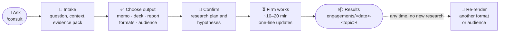
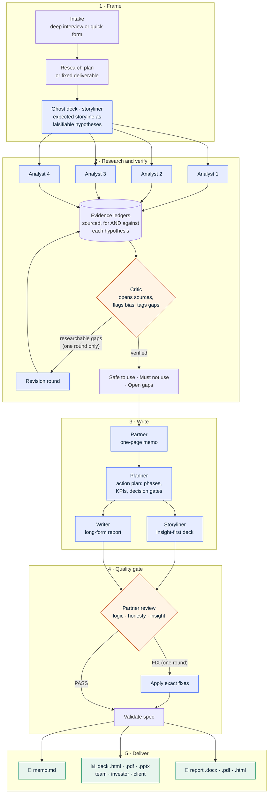

# Research Tool — an AI research firm you can run in Claude Code

A Claude Code plugin that works like a small consulting firm, on **any topic**. It sharpens your question first, plans the research, sends analyst agents out in parallel, has a critic fact-check every source, and has a partner write a short, answer-first memo that is honest about what it doesn't know.

How it differs from a generic deep-research tool:
- **It questions your question first.** A short intake turns "tell me about X" into the decision or need behind it.
- **No number reaches the memo without a checked source.** A separate critic opens the sources and throws out what doesn't hold up.
- **It knows when to stop searching.** Gaps that only you can close (a store visit, a call, your own data) become a checklist instead of more wasted searches.
- **One page, answer first.** Hard limit of 900 words before sources.
- **A deck you can present.** Insight-first slides with action titles, honest exhibits, evidence badges and an action plan — as a web deck, PDF and editable PowerPoint, cut for your team, investors or your own clients.
- **A report you can send.** A 1,800–3,000-word insights article with numbered exhibits and cited prose — as Word, PDF and a web article.

**You choose the output at the start:** memo only · memo + deck · memo + written report · all three — and which formats of each. Any format can be re-rendered later without new research.

## Install

In Claude Code:

```
/plugin marketplace add jaytran-prog/Research-Tool
/plugin install consult@research-tool
```

Restart Claude Code if the skill doesn't appear right away.

## Use

| Command | What happens |
|---------|--------------|
| `/consult` | **Deep mode:** a short interview sharpens your question, then the firm picks a deliverable |
| `/consult quick custom-research Is intermittent fasting better than calorie counting for weight loss?` | **Quick mode, any topic:** a few questions, a research plan to confirm, then research |
| `/consult quick competitor-teardown` | **Quick mode, business fast path** |

Depending on your Claude Code version, the command may appear as `/consult:consult`.

### Deliverables
| id | Answers |
|----|---------|
| `custom-research` | **Any question on any topic**: technology, science, health, policy, law, finance, history, or a personal decision. The firm designs 3–4 research workstreams for your question. |
| `competitor-teardown` | Who do I really compete with, how do they win, and where can I beat them? |
| `market-entry-check` | Should I enter this market, location, segment or product line: go, no-go, or test first? |
| `pricing-review` | Are my prices and packages right? |
| `vendor-shortlist` | Which tool or vendor should I pick, and what will it really cost? |

## How it works

### Your workflow



You make three decisions — the question, the output, and a quick check of the plan. Everything else runs on its own.

### Inside the firm



### Who does what

| Role | Model | Job | Checked by |
|------|-------|-----|------------|
| Engagement lead (you're talking to it) | your session | runs the stages, intake, final visual check | — |
| Storyliner | Opus | ghost deck before research; final deck after | partner review |
| Analysts (in parallel) | Haiku | research one workstream each, for and against every hypothesis | critic |
| Critic | Sonnet | opens the sources, catches wrong / stale / one-sided claims, tags gaps | lead |
| Partner | Opus | one-page memo | lead check |
| Planner | Sonnet | action plan: phases, owners, KPIs, gates, risks | partner review |
| Writer | Opus | long-form written report | partner review |
| Partner review | Opus | storyline, insight, honesty, exhibits — PASS or FIX | lead |

Cheap models do the volume; strong models do the judgment. Every stage that writes is checked by a different stage that didn't.

## Decks

Every slide follows consulting conventions: a full-sentence **action title**, one exhibit that proves it, a **"so what"** bar, key takeaways, sources and an **evidence badge** (strong / mixed / weak). The exhibit library covers bar charts, forest plots (effect sizes with confidence intervals), hero numbers, tables, 2×2 matrices, options with Harvey balls, issue trees, roadmaps with decision gates, KPI scorecards and a "what we know vs. assume" evidence map. A chart is only drawn when its data rule is met; otherwise the deck uses an honest qualitative exhibit, and estimates are hatched.

Render any deck yourself:

```
python3 skills/consult/scripts/render_deck.py engagements/<slug>/deck.json --formats html,pdf,pptx --cut investor --theme default
```

PDF needs Chrome or Chromium; PowerPoint needs `pip install python-pptx`. Brand themes are small JSON files in `skills/consult/scripts/themes/` (colours and fonts).

## Written reports

The written report reads like a consulting insights article: an insight headline and standfirst, an "at a glance" box, an introduction that leads with the complication, sections whose headings are conclusions, cited prose that states evidence strength in words, 4–7 numbered exhibits (the same chart library as the deck), a "what to do" section with the plan and decision gates, "what we don't know", "about this research" and sources.

```
python3 skills/consult/scripts/render_report.py engagements/<slug>/report.json --formats docx,pdf,html
```

Word needs `pip install python-docx`; charts in Word are rendered as crisp images through Chrome (Pillow required). The report reuses the deck's storyline and exhibits when both are produced, so they always agree.

Each engagement saves its brief, research plan, evidence ledgers, critic reviews and memo in `engagements/` in your working directory, and logs a row to `engagements/log.md` so you can track quality and cost over time.

> **Privacy:** `engagements/` holds your questions and any details you share. Keep it out of version control; this repo's `.gitignore` already excludes it.

> **Health, legal and financial topics:** memos are research, not professional advice, and say so.

## Repository layout

| Path | Role |
|------|------|
| `.claude-plugin/plugin.json` | Plugin manifest |
| `.claude-plugin/marketplace.json` | Lets others install the plugin from this repo |
| `skills/consult/SKILL.md` | Orchestrator: stages, modes, budgets, revision rules |
| `skills/consult/intake.md` | Diagnostic interview guide (business and general probes) |
| `skills/consult/deliverables/custom-research.md` | Any-topic deliverable: planning rules, source guide by topic type, critic checklist, memo template |
| `skills/consult/deliverables/*.md` | Business fast paths: questions, workstreams, budgets, checklist, memo template |
| `agents/consult-analyst.md` | Researches one workstream and writes a sourced ledger |
| `agents/consult-critic.md` | Fact-checks ledgers, tags gaps, returns PASS or REVISE |
| `agents/consult-partner.md` | Writes the memo |
| `agents/consult-storyliner.md` | Ghost deck before research; final insight-first deck spec after |
| `agents/consult-planner.md` | Action plan: phases, owners, KPIs, gates, risks |
| `agents/consult-deck-reviewer.md` | Partner review of the deck or written report before delivery |
| `agents/consult-writer.md` | Writes the long-form report |
| `skills/consult/report/guide.md` | Report style rules, structure and `report.json` format |
| `skills/consult/scripts/render_report.py` | Validates and renders reports (Word, PDF, web) |
| `skills/consult/deck/storyline.md` | Insight-first rules, action titles, slide skeleton, audience cuts |
| `skills/consult/deck/spec.md` | `deck.json` format, exhibit library and data rules |
| `skills/consult/scripts/render_deck.py` | Validates and renders decks (HTML, PDF, PowerPoint) |
| `skills/consult/scripts/themes/` | Visual themes |
| `docs/ideas/ai-consulting-firm.md` | Product one-pager: assumptions, scope, what we're not doing |

## Develop locally

Clone the repo and load it as a local plugin:

```
claude --plugin-dir ./Research-Tool
```

### Add a fast-path deliverable
Copy a file in `skills/consult/deliverables/`, change its questions, workstreams, budgets, checklist and template, then add it to the Deliverables table in `skills/consult/SKILL.md`. Bump `version` in `.claude-plugin/plugin.json` and `marketplace.json` so users get the update.

## Status and test history

Prototype, v0.5.1.

| Version | Test | What we learned |
|---------|------|-----------------|
| v0.1.0 | Competitor Teardown for a fictional coffee shop in Ho Chi Minh City, against real competitors | The critic caught real errors (wrong district, two shops merged, stale prices, a compromised website). Memo too long (1,595 words). Local data thin. |
| v0.2.0 | Same test, with a client evidence pack and bigger budgets | Memo 891 words; nearby competitors found on the first pass; the client's own numbers made the advice concrete. But about 2× the searches, mostly spent proving current prices aren't online. |
| v0.3.0 | Custom Research on a health question: intermittent fasting vs calorie counting | Strong sources (BMJ 2025 review of 99 trials, Cochrane 2026, a 12-month *Annals* trial). The critic caught a missed key trial, misread figures and an invented "client-named" trial; an analyst corrected the critic's p-value. Memo 883 words, mixed evidence, with a professional-advice line and a do-it-yourself checklist. Problems: fallback agents used the browser, about 12 fetches blocked by journal and guideline sites, one analyst gave up early. |

**v0.3.0 changes:**
- **Any topic:** new `custom-research` deliverable with a confirmed research plan and a source guide per topic type (business, technology, science/health, policy/law, finance, history, personal decisions). Intake, agents and memo are topic-neutral.
- **Stop searching for what isn't online:** the critic tags each gap as researchable or client/field-only, and the revision round only chases researchable gaps (or is skipped).
- **"Close the gaps yourself"** checklist in every memo.
- **Competitor Teardown** now requires competitor prices or menu photos (or an explicit "I don't know") and asks for the client's address.
- Professional-advice line for health, legal and financial memos.

**v0.5.0 — written reports:**
- New `consult-writer` agent and report guide: a long-form insights article built from the same verified evidence, reusing the deck's storyline and exhibits.
- Renderer for Word (with chart images, superscript citations, footers), PDF and web article; the deck reviewer now also reviews reports.
- Users pick memo only, memo + deck, memo + report, or all three at intake.
- Roadmaps with 3+ decision gates or at narrow widths use numbered gate markers with a legend.
- Tested on the health engagement: about 2,980 words, 6 exhibits, rendered to Word, PDF and web.

**v0.4.0 — research decks:**
- Ghost deck before research: the storyline as falsifiable hypotheses; analysts must search for evidence against each one, and the critic flags one-sided research.
- New agents: storyliner (ghost deck and final deck), planner (action plan), deck reviewer (partner review).
- Deck spec, exhibit library with data rules, and a renderer for web deck, PDF and editable PowerPoint (native charts and tables), with audience cuts and themes.
- Tested on the health engagement: 14-slide deck (13 in the investor cut). The deck review caught an overclaiming title, unlabelled client facts, an overstated safety line, a miscounted roadmap and an evidence grade set too high; all 10 fixes were applied before rendering. The ghost-deck stage itself is not yet tested end to end.

**v0.3.1 changes (from the health test):**
- Fallback agents are told to use only search, fetch, read and write (plus paper search if available), never a browser or terminal.
- Analysts try open copies of blocked pages (PubMed Central, Europe PMC, DOI, PubMed abstract, repositories; guideline PDFs and journal summaries) before giving up, then hand the link to the client.
- Analysts must make at least two attempts before calling something "not found", and can't leave half their budget unused with questions open.
- Nothing may be attributed to the client unless it's in the brief; full text beats abstracts when they disagree.
- The critic checks effort, attribution and version mismatches, and runs a quick check for key studies the analysts missed.
- The lead check counts words with a real tool and checks client-provided labels.

## License

MIT
